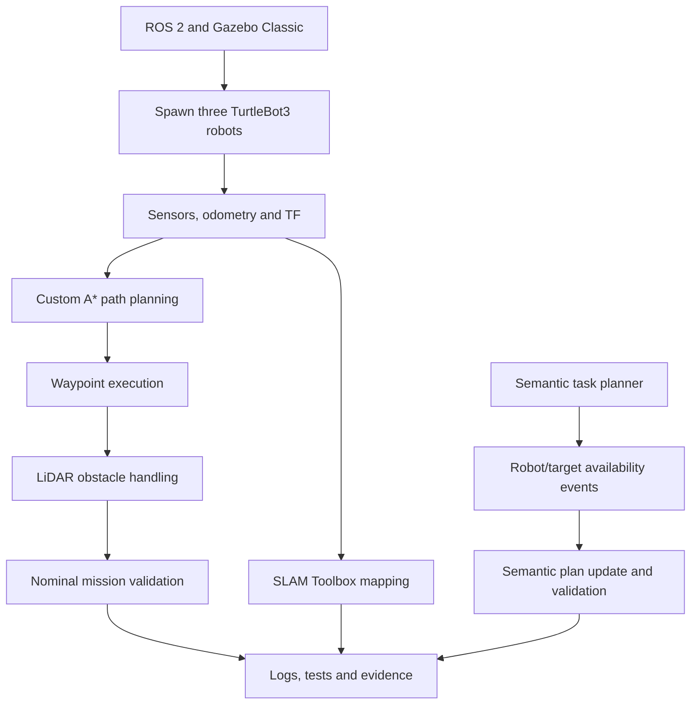

# Multi-Robot Inspection: Simulation and Semantic Planning

A ROS 2 and Gazebo Classic project exploring multi-robot inspection, waypoint allocation, static-world path planning, semantic task planning, and event-driven replanning in a simulated environment.

The project uses three TurtleBot3 Burger robots in a shared Gazebo world. It combines a reproducible simulation setup with a tested waypoint mission, a custom A* planner, a semantic planning baseline, validation of model-generated plans, and software-level responses to mission events.

## 1. Project Overview

The project investigates how multiple simulated robots can be configured for inspection tasks, navigate toward assigned waypoints, and respond to high-level task descriptions and changes in mission conditions.

The implementation is organised around four areas:

- **Multi-robot simulation:** launch three robots in a shared Gazebo Classic environment with namespaced ROS 2 topics.
- **Navigation and inspection:** use a custom A* planner based on static geometry from the Gazebo world and execute a ten-waypoint mission.
- **Semantic task planning:** translate inspection requests into structured tasks using a deterministic planner or an optional locally hosted language model.
- **Validation and event handling:** validate proposed plans against configured scene entities and demonstrate software-level replanning when a robot or inspection target becomes unavailable.

The repository includes source code, configuration, automated tests, validation records, logs, and a project report.

## 2. Implementation Status

| Component | Status | Evidence / Notes |
|---|---|---|
| ROS 2 Humble workspace | Implemented | Workspace builds and launches in the documented environment |
| Three-robot Gazebo simulation | Implemented and tested | `r0`, `r1`, and `r2` spawn in the shared world |
| Namespaced robot topics | Verified | Robot-specific command and sensor topics |
| Odometry and TF | Verified | Dynamic odometry and robot-link transforms checked |
| LiDAR | Verified | Scan topics available for all three robots |
| RGB-D cameras | Configured and verified | RGB, depth, camera information, and point-cloud topics checked |
| SLAM Toolbox | Partially demonstrated | A partial map was saved from the `r0` mapping setup |
| Custom A* planner | Implemented and tested | Uses static obstacles extracted from Gazebo SDF geometry |
| Ten-waypoint inspection mission | Completed in a recorded run | All ten unique waypoints reached in the A*-enabled Gazebo run |
| Failure detection and waypoint reassignment | Implemented and exercised | Failure-injection logs record reassignment and subsequent task activity |
| Deterministic semantic planning | Implemented | Produces structured inspection tasks from configured scene knowledge |
| LLM-based semantic planning | Implemented and tested | Uses Ollama with Qwen 2.5 1.5B and structured plan output |
| Semantic plan validation | Implemented and tested | Checks supported actions, known entities, robot availability, and task consistency |
| Event-driven semantic replanning | Demonstrated at software level | Scripted robot and target availability changes produce updated plans |
| Automated regression tests | Recorded test results | 61 collected, 60 passed, 1 skipped, 0 failed |

The test counts above reflect the recorded regression run; they are not a claim that the suite was rerun when this README was edited.

## 3. System Workflow

The diagram summarises the principal project components and their relationships. The semantic-planning demonstration is a separate software-level pipeline rather than an end-to-end extension of the A*-based robot execution pipeline.




The navigation and semantic-planning components are separate parts of the implementation. The diagram represents the project architecture; it does not imply that semantic plans are automatically executed by the navigation stack.

## 4. Technology Stack

- Ubuntu 22.04 / WSL2
- ROS 2 Humble
- Gazebo Classic
- TurtleBot3 Burger simulation
- Python
- ROS 2 launch and package tooling
- `robot_state_publisher`
- Xacro / URDF and robot-description resources
- `tf2_ros`
- `gazebo_ros_pkgs`
- Gazebo ROS camera plugins
- `turtlebot3_gazebo`
- `turtlebot3_description`
- Custom grid-based A* planning
- SLAM Toolbox
- Navigation2 packages in the ROS environment
- Ollama with Qwen 2.5 1.5B for optional local LLM-based semantic planning
- `pytest` / ROS 2 package testing
- Git

## 5. Repository Structure

```text
ltu-robotics-ai-phd-assignment/
├── README.md
├── docs/
│   ├── design_decisions.md
│   ├── time_log.md
│   ├── task_2_1_validation.md
│   └── evidence/
│       └── task_2_1/
│           └── mission/
├── report/
│   ├── report.md
│   ├── references.bib
│   └── assignment_report.pdf
└── ros2_ws/
    └── src/
        └── multi_robot_sim/
            ├── config/
            ├── launch/
            ├── multi_robot_sim/
            ├── test/
            ├── worlds/
            ├── package.xml
            └── setup.py
```

The tree above highlights the main project areas. Refer to the actual repository for the complete list of source files, launch files, assets, and test modules.

## 6. Environment Setup

### Prerequisites

- Ubuntu 22.04 with ROS 2 Humble installed
- Gazebo Classic and the required ROS/Gazebo integration packages
- TurtleBot3 simulation and description packages
- A built ROS 2 workspace

The commands below assume the repository is located at `~/ltu_rai_assignment`.

### Build the workspace

```bash
cd ~/ltu_rai_assignment/ros2_ws

source /opt/ros/humble/setup.bash

rosdep install --from-paths src --ignore-src -r -y

colcon build --symlink-install
```

If the dependencies have already been installed, the `rosdep` step does not need to be repeated.

### Launch the three-robot simulation

Run the following command sequence:

```bash
cd ~/ltu_rai_assignment/ros2_ws

source /opt/ros/humble/setup.bash
source install/setup.bash

export TURTLEBOT3_MODEL=burger
export LIBGL_ALWAYS_SOFTWARE=1

ros2 launch multi_robot_sim multi_robot.launch.py
```

**Verified outcome:** Gazebo opens and all three TurtleBot3 Burger robots spawn in the shared world.

The robots are named `r0`, `r1`, and `r2`, with initial positions:

| Robot | Initial x (m) | Initial y (m) |
|---|---:|---:|
| `r0` | 0 | 0 |
| `r1` | 2 | 0 |
| `r2` | 0 | 2 |

The software-rendering environment variable is included for the documented WSL setup.

## 7. ROS 2 Namespaces and Topics

Each robot uses a namespace to separate its commands and sensor streams.

| Function | `r0` | `r1` | `r2` |
|---|---|---|---|
| Velocity command | `/r0/cmd_vel` | `/r1/cmd_vel` | `/r2/cmd_vel` |
| LiDAR scan | `/r0/scan` | `/r1/scan` | `/r2/scan` |
| IMU | `/r0/imu` | `/r1/imu` | `/r2/imu` |
| Odometry | `/r0/odom` | `/r1/odom` | `/r2/odom` |
| RGB image | `/r0/camera/color/image_raw` | `/r1/camera/color/image_raw` | `/r2/camera/color/image_raw` |
| Depth image | `/r0/camera/depth/image_raw` | `/r1/camera/depth/image_raw` | `/r2/camera/depth/image_raw` |
| RGB camera info | `/r0/camera/color/camera_info` | `/r1/camera/color/camera_info` | `/r2/camera/color/camera_info` |
| Depth camera info | `/r0/camera/depth/camera_info` | `/r1/camera/depth/camera_info` | `/r2/camera/depth/camera_info` |
| Point cloud | `/r0/camera/depth/points` | `/r1/camera/depth/points` | `/r2/camera/depth/points` |

The robots publish their transforms through the shared `/tf` and `/tf_static` topics. Their frame IDs remain robot-specific, for example `r0/base_link` and `r1/base_link`.

### Useful inspection commands

Run these commands in a separately sourced terminal while Gazebo is running:

```bash
ros2 topic list
ros2 node list
ros2 topic info /r0/scan
ros2 topic echo /r0/odom
ros2 run tf2_ros tf2_echo odom r0/base_footprint
```

The last command assumes the corresponding frames are available with those exact names in the running configuration.

## 8. Simulation and Sensor Verification

The following checks have been recorded during the development and validation work:

- All three robots spawn in the shared Gazebo world.
- Robot-specific command, LiDAR, IMU, and odometry topics are available.
- A command-isolation check observed `r0` moving while `r1` and `r2` remained stationary in that test.
- Dynamic odometry transforms and static robot-link transforms were checked for all three robots.
- RGB image, depth image, camera-information, and point-cloud topics were checked.
- Camera frame IDs and the base-to-camera transform were inspected.
- The odometry-to-camera transform chain was checked for all three robots.

### RGB-D camera configuration

| Parameter | Configuration |
|---|---|
| Image resolution | 320 × 240 |
| Configured update rate | 10 Hz |
| Horizontal field of view | 1.047 rad |
| Near clipping distance | 0.10 m |
| Far clipping distance | 8.0 m |
| Camera frame | Robot-specific `rX/camera_link` |

The configured update rate describes the model configuration, not a guarantee of the rate observed during every simulation run.

### Observed sensor rates

The development notes contain short-run measurements such as:

| Stream | Recorded observation |
|---|---|
| LiDAR | Approximately 3.2–4.0 Hz in preliminary measurements for `r0`/`r1`; approximately 3.4–3.6 Hz for `r2` in one measurement |
| LiDAR, later short run | Approximately 8.7 Hz |
| RGB image | Approximately 6.7 Hz for `r0` and 7 Hz for `r1` in recorded checks |
| Depth image | Approximately 6.5–7.2 Hz in recorded checks |

These are session-specific observations under simulation and WSL load, not guaranteed performance figures. The recorded checks did not establish a stable RGB publication rate for `r2`.

## 9. Waypoint Planning and Mission Execution

The navigation work includes a custom A* planner that derives static obstacle geometry from the Gazebo world description in SDF format.

The planner configuration recorded in the project includes:

- Grid resolution: **0.10 m**
- Obstacle inflation radius: **0.22 m**
- Odometry-based path following
- LiDAR-based stop/resume thresholds of **0.45 m / 0.60 m**

The A* planner uses the static world geometry as its planning input. It is distinct from planning over the map generated by SLAM Toolbox.

### Nominal mission result

A recorded A*-enabled Gazebo run reached all ten unique waypoints, `wp01` through `wp10`.

The mission log reports `MISSION_COMPLETE`, with all ten waypoints reached and no unresolved waypoints. The recorded final goal distance for `wp10` was approximately 0.049 m.

The nominal mission evidence is available under:

```text
docs/evidence/task_2_1/mission/
```

The repository also contains the mission execution and validation documentation.

### Reproduce the mission

1. Start the three-robot Gazebo simulation using the launch command in Section 6.
2. Open another terminal and source the ROS 2 and workspace environments.
3. Start the mission executor:

```bash
cd ~/ltu_rai_assignment/ros2_ws

source /opt/ros/humble/setup.bash
source install/setup.bash

ros2 run multi_robot_sim mission_executor
```

4. Monitor the mission status:

```bash
ros2 topic echo /mission/status
```

5. Allow the nominal run to proceed and check for `MISSION_COMPLETE`.

Use a fresh nominal run without failure injection when reproducing the ten-waypoint completion result.

### Failure-injection experiment

The project also exercises the executor's response to robot unavailability. In the recorded experiment, marking `r0` failed caused the executor to report `ROBOT_FAILED` and redistribute four unfinished waypoints among the remaining robots.

The available recovery log subsequently records timeout and requeue events, successful completion of `wp06` and `wp09`, and the start of `wp04` by `r2`.

To trigger the failure event in a separate experiment, use:

```bash
ros2 topic pub --once /mission/failed_robot std_msgs/msg/String "{data: r0}"
```

This command injects a software-level failure event; it does not physically damage or disable a robot.

## 10. Mapping and Navigation Configuration

SLAM Toolbox was configured for the `r0` mapping setup, and a partial map was saved.

The recorded map characteristics are:

| Property | Recorded value |
|---|---:|
| Resolution | 0.05 m/cell |
| Width | 152 cells |
| Height | 160 cells |
| Known-cell coverage | Approximately 63.5% |

The map demonstrates that mapping was exercised in the simulation. It is not a ground-truth accuracy evaluation.

The custom A* planner and the SLAM workflow serve different purposes: A* derives static obstacles from the Gazebo SDF, while SLAM Toolbox builds a map from sensor observations.

## 11. Semantic Planning

The semantic-planning components explore the conversion of inspection requests into structured, validated tasks.

### Scene representation

The configured scene graph is stored at:

```text
ros2_ws/src/multi_robot_sim/config/semantic/scene_graph.json
```

It describes configured robots, inspection locations, obstacles, and semantic relations. It provides the scene knowledge used by the planner; it is not an automatically perceived, continuously updated world model.

### Deterministic planner

`semantic_planner.py` provides a deterministic natural-language planning baseline. It uses configured scene knowledge to construct structured inspection tasks.

### LLM-based planner

`llm_semantic_planner.py` provides an optional model-backed planning path using a locally hosted **Qwen 2.5 1.5B** model through the Ollama HTTP API.

The planner requests structured JSON output, including task identifiers, actions, targets, and robot assignments. It grounds proposed targets against the configured scene entities and normalises supported action names and accepted aliases.

The model-backed path is intended to produce structured plans rather than directly issuing low-level robot motion commands.

### Plan validation

`semantic_validator.py` checks generated plans for issues including:

- Malformed plan structure
- Unsupported actions
- Unknown target or robot identifiers
- Unavailable robots
- Duplicate task identifiers

For example, an unknown target such as `made_up_room` is rejected rather than accepted as a valid configured inspection location.

### Run the semantic components

With the workspace built and sourced, run the desired component in its own terminal:

```bash
ros2 run multi_robot_sim semantic_planner
```

```bash
ros2 run multi_robot_sim llm_semantic_planner
```

```bash
ros2 run multi_robot_sim semantic_events
```

The LLM-based planner requires Ollama to be available locally and the configured model to be installed. The deterministic planner and event-handling demonstrations do not depend on successful LLM generation.

## 12. Event-Driven Semantic Replanning

The semantic event-handling component demonstrates how a plan can be updated when relevant mission conditions change.

The recorded event scenario includes:

1. Marking robot `r0` unavailable and reallocating inspection work to available robots.
2. Marking the `inspection_east` target unavailable.
3. Generating an updated plan that uses `inspection_north` instead.
4. Checking that the resulting plan is valid and that the event log contains no reported errors.

This demonstrates software-level event handling and semantic plan updates using the configured scene graph and deterministic planning logic.

## 13. Automated Tests

The project contains tests covering waypoint planning, semantic validation, LLM planner behaviour, and semantic events.

Relevant test files include:

```text
ros2_ws/src/multi_robot_sim/test/
├── test_waypoint_planner.py
├── test_semantic_validator.py
├── test_llm_semantic_planner.py
└── test_semantic_events.py
```

The recorded regression run collected **61 tests**, with **60 passed, 1 skipped, and 0 failed**.

### Run the tests

```bash
cd ~/ltu_rai_assignment/ros2_ws

source /opt/ros/humble/setup.bash
source install/setup.bash

colcon test --packages-select multi_robot_sim --event-handlers console_direct+
colcon test-result --verbose
```

The commands above run the test suite again and display its results; the historical test count in this README should not be interpreted as a result of a new run.

## 14. Evidence and Documentation

The repository includes supporting implementation notes, validation records, and report materials.

| Resource | Purpose |
|---|---|
| `docs/design_decisions.md` | Design choices and technical rationale |
| `docs/time_log.md` | Development activity log |
| `docs/task_2_1_validation.md` | Waypoint mission validation and follow-up observations |
| `docs/evidence/task_2_1/mission/` | Recorded mission evidence and logs |
| `report/report.md` | Main project report |
| `report/references.bib` | Bibliographic references used by the report |
| `report/assignment_report.pdf` | PDF report, to be regenerated from the final report Markdown |

Evidence should be interpreted according to the experiment that produced it. In particular, the nominal mission log and failure-injection log represent separate runs and different outcomes.

## 15. Scope, Limitations, and Next Steps

The project establishes a working multi-robot simulation, a tested custom A*-enabled waypoint mission, semantic planning and validation components, and software-level event-handling demonstrations. The following boundaries define the current scope:

- The recorded ten-waypoint completion applies to the nominal A*-enabled simulation run. The available failure-injection log does not establish successful completion of the entire mission after robot failure.
- The SLAM result is a partial map from the `r0` mapping setup; map accuracy against ground truth and multi-robot map merging have not been demonstrated.
- Nav2 global planning has not been configured and validated as part of the demonstrated mission.
- The custom A* planner uses static Gazebo SDF geometry rather than the SLAM-generated map.
- Semantic planning, validation, and event-driven replanning have been demonstrated at the software level; an end-to-end pipeline from LLM-generated semantic tasks to executed robot navigation has not been established.
- Sensor publication rates vary with simulation and system load. The recorded short-run measurements are not benchmark guarantees.
- The demonstrations are simulation-based; physical robot deployment has not been established.

Potential next steps include improving map coverage and evaluating map accuracy, configuring and validating Nav2 independently, expanding failure-recovery tests, evaluating semantic planning across more language inputs and failure cases, and maintaining reproducible test and report evidence.

## 16. License

No root-level `LICENSE` file is currently included in the repository. No specific open-source licence is claimed by this README.
