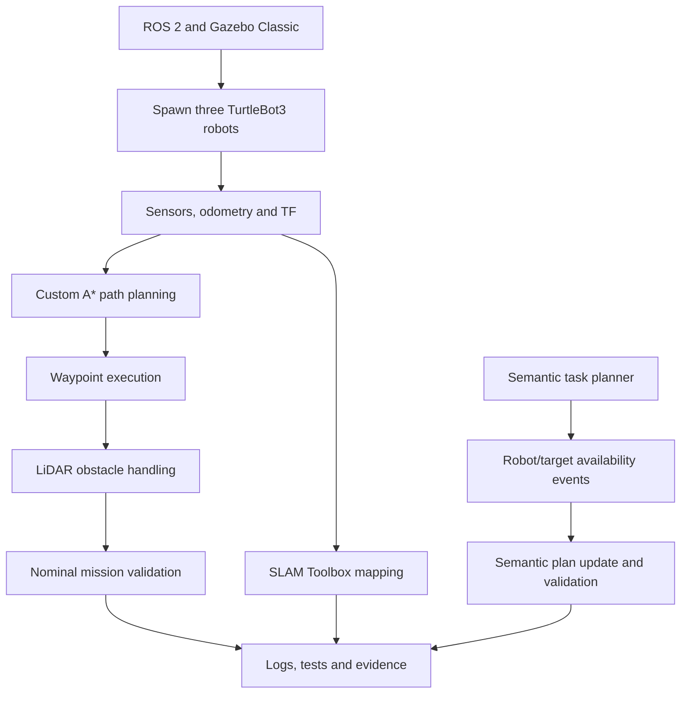

# Multi-Robot Inspection: Simulation and Semantic Planning

A ROS 2 and Gazebo Classic research prototype for multi-robot inspection, waypoint execution, semantic task planning, and event-driven replanning.

This project brings together a three-robot simulation, a custom A*-based waypoint planner, LiDAR-assisted obstacle handling, SLAM mapping, semantic task assignment, and event-handling components. The repository includes implementation code, automated tests, recorded execution evidence, mapping artifacts, and technical documentation.

**Repository:** [Akshit-Sh/ltu-robotics-ai-phd-assignment](https://github.com/Akshit-Sh/ltu-robotics-ai-phd-assignment)

## 1. Project Overview

The project investigates how multiple simulated robots can execute inspection missions and how planning components can respond to changes in robot availability and inspection targets.

The main objectives are to:

- Develop and launch a multi-robot simulation environment.
- Implement custom A*-based path planning and waypoint execution.
- Handle obstacles using LiDAR observations.
- Generate occupancy-grid maps using SLAM Toolbox.
- Develop semantic task assignment and plan-validation components.
- Demonstrate event handling for unavailable robots and inspection targets.
- Validate the implementation through automated tests and recorded simulation evidence.

## 2. Implementation Status

The following table summarizes the principal components and their implementation status.

| Component | Status | Result |
|---|---|---|
| ROS 2 and Gazebo Classic | Implemented | Simulation launches successfully |
| Multi-robot simulation | Implemented and tested | Three TurtleBot3 Burger robots spawned with separate namespaces |
| Robot topics and TF | Configured and inspected | Namespaced sensor, odometry, and command interfaces available |
| LiDAR and RGB-D sensors | Configured and inspected | Sensor data observed during simulation |
| SLAM Toolbox | Executed | Per-robot mapping experiment produced a saved partial map |
| Custom A* planner | Implemented and tested | Paths generated using static obstacle geometry from Gazebo SDF |
| Obstacle handling | Implemented and observed | LiDAR-based stop and clearance events recorded during waypoint execution |
| Ten-waypoint mission | Successfully completed in nominal simulation | All ten unique waypoints reached; `MISSION_COMPLETE` recorded |
| Robot-failure handling | Implemented and exercised | Failure detection and waypoint reassignment observed |
| Semantic task planning | Implemented and tested at software level | Inspection tasks assigned to available robots |
| Semantic event handling | Implemented and demonstrated | Robot and target availability events updated planning state and resulting plans |
| Automated tests | Recorded test suite | 61 collected, 60 passed, 1 skipped, 0 failed |
| Nav2 global planning | Not configured or validated | Not part of the validated implementation |

The status table distinguishes implemented components, observed results, and work that remains outside the validated scope.

## 3. System Workflow

The diagram summarizes the principal project components and their relationship. The semantic planning demonstration is a separate software-level pipeline rather than an end-to-end extension of the A*-based robot execution pipeline.



## 4. Technology Stack

| Category | Technology |
|---|---|
| Operating system | Ubuntu 22.04 |
| Development environment | WSL2 on Windows |
| Robotics middleware | ROS 2 Humble |
| Simulator | Gazebo Classic |
| Robot platform | TurtleBot3 Burger |
| Build system | `colcon` |
| Path planning | Custom A* implementation |
| Robot control | Odometry-based path following |
| Obstacle sensing | LiDAR |
| Mapping | SLAM Toolbox |
| Semantic planning | Python-based planning and validation components |
| Testing | ROS 2 package tests and Python tests |

The commands below assume ROS 2 Humble and the required Gazebo Classic and TurtleBot3 dependencies are installed.

## 5. Repository Structure

```text
ltu-robotics-ai-phd-assignment/
├── README.md
├── ros2_ws/
│   └── src/
│       └── multi_robot_sim/
│           ├── launch/
│           ├── models/
│           ├── worlds/
│           ├── test/
│           └── ...
├── docs/
│   ├── design_decisions.md
│   ├── task_2_1_validation.md
│   └── evidence/
│       ├── task_2_1/
│       │   ├── mapping/
│       │   └── mission/
│       └── task_2_2/
└── report/
    ├── report.md
    └── references.bib
```

This is a simplified view of the repository. The actual directories contain additional source files, tests, configuration files, and supporting evidence.

## 6. Reproducibility and Setup

### 6.1 Build the workspace

Open a WSL/Ubuntu terminal and run:

```bash
source /opt/ros/humble/setup.bash

cd ~/ltu_rai_assignment/ros2_ws

export TURTLEBOT3_MODEL=burger

colcon build --packages-select multi_robot_sim

source install/setup.bash
```

If the workspace has already been built and the source code has not changed, you can source the existing installation instead of rebuilding:

```bash
source /opt/ros/humble/setup.bash
source ~/ltu_rai_assignment/ros2_ws/install/setup.bash

export TURTLEBOT3_MODEL=burger
```

### 6.2 Launch Gazebo and spawn all three robots

The following launch command has been confirmed to open Gazebo and spawn the three robots in the project environment.

```bash
cd ~/ltu_rai_assignment/ros2_ws

source /opt/ros/humble/setup.bash
source install/setup.bash

export TURTLEBOT3_MODEL=burger
export LIBGL_ALWAYS_SOFTWARE=1

ros2 launch multi_robot_sim multi_robot.launch.py
```

Keep this terminal running while the simulation is active.

`LIBGL_ALWAYS_SOFTWARE=1` enables software OpenGL rendering, which can be useful in WSL environments.

### 6.3 Robot configuration

The launch configuration uses three TurtleBot3 Burger robots in a shared Gazebo world.

| Robot | Namespace | Initial position |
|---|---|---|
| Robot 0 | `r0` | `(0, 0)` m |
| Robot 1 | `r1` | `(2, 0)` m |
| Robot 2 | `r2` | `(0, 2)` m |

Each robot uses namespaced ROS 2 interfaces to separate its command, odometry, and sensor data.

### 6.4 Verify the running simulation

Open a second WSL/Ubuntu terminal:

```bash
source /opt/ros/humble/setup.bash
source ~/ltu_rai_assignment/ros2_ws/install/setup.bash

ros2 node list
```

Inspect the principal robot topics:

```bash
ros2 topic list | grep -E '^/r[0-2]/(cmd_vel|odom|scan|imu)$'
```

Check odometry and LiDAR data:

```bash
ros2 topic echo /r0/odom --once
ros2 topic echo /r0/scan --once
```

These checks help confirm that the ROS 2 graph and sensor interfaces are active.

### 6.5 Troubleshooting

If ROS 2 cannot locate the package:

```bash
source /opt/ros/humble/setup.bash
source ~/ltu_rai_assignment/ros2_ws/install/setup.bash

ros2 pkg prefix multi_robot_sim
```

If the package is missing, rebuild from the workspace:

```bash
cd ~/ltu_rai_assignment/ros2_ws

source /opt/ros/humble/setup.bash

colcon build --packages-select multi_robot_sim
source install/setup.bash
```

If Gazebo fails to load, check the required Gazebo Classic and TurtleBot3 dependencies and confirm that the environment has been sourced.

## 7. ROS 2 Namespaces and Topics

The simulation uses separate namespaces for `r0`, `r1`, and `r2`.

| Interface | Example topic | Purpose |
|---|---|---|
| Velocity command | `/r0/cmd_vel` | Send motion commands to robot `r0` |
| Odometry | `/r0/odom` | Read robot motion and position estimates |
| LiDAR scan | `/r0/scan` | Obtain range measurements for obstacle handling |
| IMU | `/r0/imu` | Obtain inertial sensor data |

The same naming pattern applies to the other robots where the corresponding interfaces are configured.

## 8. Waypoint Planning and Mission Execution

The waypoint execution pipeline uses a custom A* planner to generate paths through static obstacles defined in the Gazebo world model. The executor follows these paths using odometry and uses LiDAR observations to pause and resume motion around detected obstacles.

The documented configuration includes:

| Parameter | Value |
|---|---:|
| A* grid resolution | `0.10 m` |
| Obstacle inflation | `0.22 m` |
| Obstacle-stop threshold | `0.45 m` |
| Obstacle-clearance threshold | `0.60 m` |

### Nominal mission result

The recorded nominal A*-enabled simulation run completed all ten unique waypoints, `wp01` through `wp10`.

| Metric | Recorded result |
|---|---|
| Final mission status | `MISSION_COMPLETE` |
| Unique waypoints reached | 10/10 |
| Unresolved waypoints | 0 |
| Failed robots | 0 |
| Final goal distance at `wp10` | Approximately `0.049 m` |

Obstacle-stop and obstacle-clearance events were also observed during the run.

**Evidence:**
- `docs/evidence/task_2_1/mission/mission_result.md`
- `docs/evidence/task_2_1/mission/mission_run.log`

The validation procedure and additional observations are documented in `docs/task_2_1_validation.md`.

## 9. Mapping and Sensor Configuration

SLAM Toolbox was used for per-robot mapping experiments. The repository contains saved map images, occupancy-grid metadata, and related configuration files.

The recorded map artifact has the following properties:

| Property | Recorded value |
|---|---:|
| Resolution | `0.05 m/cell` |
| Dimensions | `152 × 160` cells |
| Known-cell coverage | Approximately `63.5%` |

The active robot models configure LiDAR at `10 Hz`. Configured sensor update rates and observed runtime publication rates are different measurements, and observed rates can vary with simulation load and execution conditions.

**Mapping evidence:** `docs/evidence/task_2_1/mapping/`

## 10. Semantic Planning and Event Handling

The semantic planning components represent inspection tasks, robot assignments, and changes in mission conditions. The event-handling demonstration includes:

- Marking a robot unavailable.
- Updating the planning state after a robot becomes unavailable.
- Marking an inspection target unavailable.
- Producing revised plans in response to these events.
- Recording event state and plan-validation results.

The saved demonstration records robot and target unavailability events and shows the resulting plans without reported errors.

**Evidence:** `docs/evidence/task_2_2/event_replanning_demo.log`

The associated tests cover semantic planning, validation, and event handling. These results demonstrate software-level planning behavior.

## 11. Automated Tests

The latest documented test summary is:

| Test result | Count |
|---|---:|
| Tests collected | 61 |
| Passed | 60 |
| Skipped | 1 |
| Failed | 0 |

These figures describe the recorded test run and are not a guarantee that a new run will produce identical results.

To build the package and run its registered tests:

```bash
cd ~/ltu_rai_assignment/ros2_ws

source /opt/ros/humble/setup.bash

colcon build --packages-select multi_robot_sim
source install/setup.bash

colcon test --packages-select multi_robot_sim
colcon test-result --verbose
```

Compare the output with the recorded summary when validating the current environment.

## 12. Evidence and Documentation

The repository contains supporting design notes, validation records, execution logs, mapping artifacts, and report sources.

| Resource | Purpose |
|---|---|
| `docs/design_decisions.md` | Design rationale and technical decisions |
| `docs/task_2_1_validation.md` | Waypoint execution and mapping validation |
| `docs/evidence/task_2_1/mission/` | Nominal mission and failure-injection evidence |
| `docs/evidence/task_2_1/mapping/` | Saved map artifacts and mapping notes |
| `docs/evidence/task_2_2/event_replanning_demo.log` | Semantic event-handling output |
| `report/report.md` | Main technical report source |
| `report/references.bib` | Bibliographic entries for the report |

The evidence separates successful nominal execution from the failure-injection experiment, allowing each result to be evaluated independently.

## 13. Development Status

The current project provides a working simulation environment, custom path planning, waypoint execution, mapping experiments, and software-level semantic planning and event handling.

The implementation and validation work has focused on:

- Establishing a reproducible three-robot simulation.
- Implementing and exercising custom A*-based waypoint planning.
- Recording obstacle-handling behavior during mission execution.
- Producing mapping artifacts.
- Testing semantic task planning and event-driven plan updates.
- Maintaining execution evidence and automated tests.

Further work can build on these components to improve integration, robustness, and evaluation.

## 14. Scope and Limitations

The project demonstrates the components and outcomes described above within the tested simulation and software environment. The following boundaries define the current scope:

- **Planning integration:** The custom A* planner uses static obstacle geometry from the Gazebo SDF rather than planning directly from the saved SLAM occupancy grid. Nav2 global planning has not been configured and validated in this project.
- **Failure recovery:** Robot-failure detection and waypoint reassignment were observed. The recorded failure-injection run did not establish end-to-end mission completion after the failure.
- **Semantic execution:** Semantic task planning and event handling are demonstrated at the software level; they are not integrated end-to-end with physical robot execution.
- **Mapping evaluation:** The saved SLAM map is partial, and ground-truth map-accuracy evaluation has not been established.
- **Deployment:** The reported experiments are simulation-based and do not establish physical-robot performance or multi-robot map merging.

These boundaries distinguish the current implementation and observed results from potential future extensions.

## 15. License

No license file is currently included in this repository.
