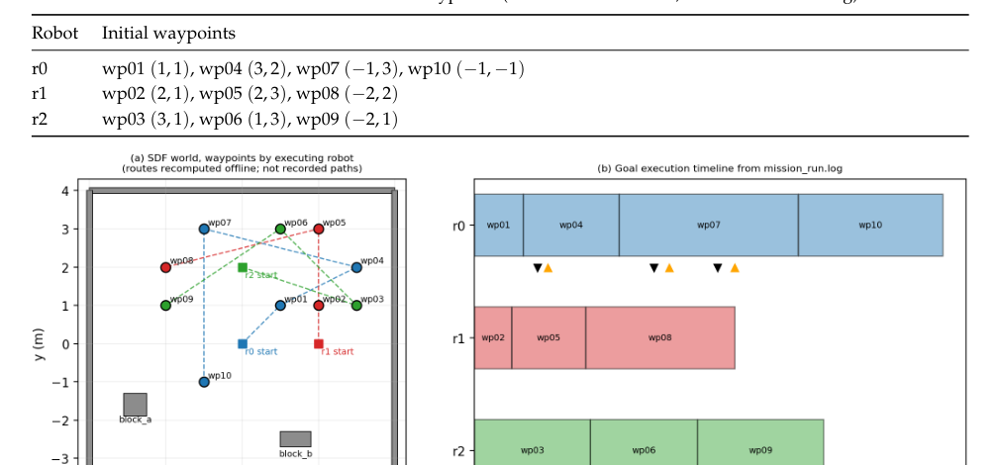
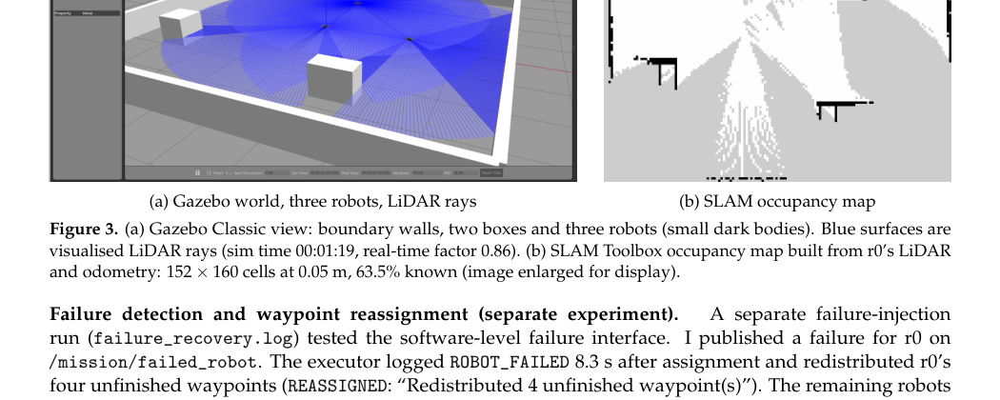
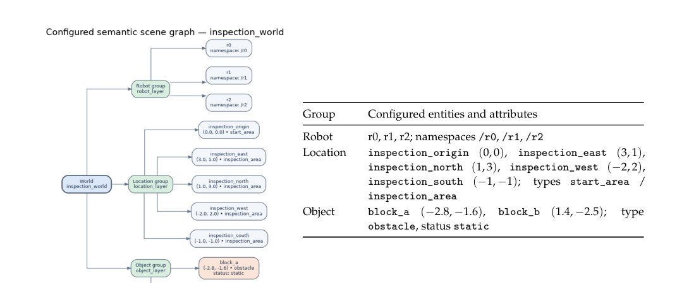
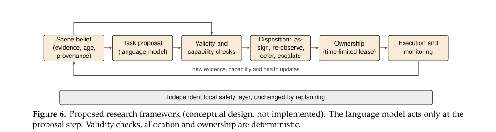

# 1. Introduction

This project develops and evaluates a multi-robot inspection baseline using ROS 2 Humble and Gazebo Classic. The implementation combines three simulated TurtleBot3 Burger robots, namespaced sensing and control interfaces, a custom A\*-based waypoint navigation pipeline, SLAM Toolbox mapping, and a separate semantic task-planning prototype. The work is supported by simulation runs, software-level demonstrations, automated tests, and recorded validation evidence.

The project has two complementary parts. The first establishes and evaluates a multi-robot simulation workflow, including a ten-waypoint inspection mission, static-world A\* planning, LiDAR-based stop/resume behaviour, and a partial occupancy map. The second explores language-grounded semantic task planning, structured-plan validation, and event-driven updates to robot and target availability. The report also develops a research direction for maintaining reliable semantic missions over longer deployments.

## Project Summary

| Area | Implemented work | Recorded outcome |
|---|---|---|
| Multi-robot simulation | Three namespaced TurtleBot3 Burger robots in Gazebo Classic | All three robots spawned in the shared world |
| Navigation | Custom A* static-world planner, odometry-based path following, LiDAR stop/resume guard | Recorded nominal mission reached all ten unique waypoints |
| Mapping | SLAM Toolbox with LiDAR and odometry | Partial 152 × 160 occupancy map saved at 0.05 m/cell |
| Semantic planning | Deterministic baseline and optional Ollama/Qwen model-backed planner | Structured plans grounded against configured scene entities |
| Plan validation | Checks plan structure, task IDs, actions, targets, robot IDs, and availability | Invalid target and malformed-plan cases rejected in regression tests |
| Event handling | Scripted robot-unavailable and target-unavailable events | Updated semantic plans validated at software level |
| Testing | ROS 2 package regression tests | Recorded run: 60 passed, 1 skipped, 0 failed out of 61 collected |

## 2.1 Multi-Robot Simulation, Sensing, and Mapping

### System Configuration

Three TurtleBot3 Burger robots, named r0, r1, and r2, were spawned in a shared Gazebo Classic world at initial positions (0, 0), (2, 0), and (0, 2) metres. Robot-specific namespaces separate command and sensor interfaces, including /rX/cmd_vel, /rX/scan, /rX/imu, and /rX/odom. RGB-D streams are configured at 320 × 240 pixels with a target update rate of 10 Hz. Robot-specific TF frame prefixes allow the robots to publish transforms on the shared /tf and /tf_static topics without reusing frame IDs.

The environment was developed on Ubuntu 22.04 under WSL2 with ROS 2 Humble and Gazebo Classic. Gazebo was launched with software rendering in the documented WSL setup.

### Sensor Observations

Short measurements in the WSL2 environment recorded RGB publication rates of approximately 6.7 Hz for r0 and 7.0 Hz for r1. Available depth measurements were approximately 6.5–7.2 Hz. Earlier LiDAR checks measured approximately 3.2–4.0 Hz. A later short LiDAR check recorded approximately 8.7 Hz. These values are observations from particular sessions and are presented as measurements rather than guaranteed performance rates.

*Figure 1. Recorded sensor publication rates compared with the configured 10 Hz target. Measurements depend on the simulation session and system load.*

### Waypoint Mission and A* Navigation

A centralized waypoint executor ran ten unique waypoints, wp01–wp10, with a goal tolerance of 0.15 m. In the successful A\*-enabled Gazebo run, the executor emitted MISSION_COMPLETE, recorded all ten waypoint IDs as completed, and ended with empty unresolved and failed-robot lists. The logged final goal distances were approximately 0.048–0.050 m, within the configured tolerance.

The corrected-world integration run on 18 October 2026 used inspection_world.world, with boundary walls and static obstacles visible in Gazebo. The run recorded multiple OBSTACLE_STOP and OBSTACLE_CLEARED transitions, including during wp03, wp04, and wp07. These events demonstrate the configured forward LiDAR stop/resume behaviour during the recorded run.

The custom A\* planner parses known static collision-box geometry from the Gazebo SDF world. It uses a 0.10 m grid resolution and 0.22 m obstacle inflation, then simplifies the resulting route using line-of-sight checks. The executor follows the path using odometry-based motion control. A forward LiDAR guard stops for close returns at 0.45 m and resumes when clearance exceeds 0.60 m. A separate test across block_b produced a four-point route with 0.70 m maximum lateral deviation from the direct line.

**Recorded Nominal Mission Result**

| Measure | Recorded result |
|---|---|
| Unique waypoints | 10 (wp01–wp10) |
| Waypoints completed | 10/10 |
| Goal tolerance | 0.15 m |
| Final goal distances | Approximately 0.048–0.050 m |
| Unresolved waypoints at completion | 0 |
| Failed robots at completion | 0 |
| Mission status | `MISSION_COMPLETE` |

The successful nominal run provides a repeatable baseline for further experiments on navigation, disturbance handling, and multi-robot inspection.\n\n\n\n*Figure 3. Recorded nominal mission allocation and execution timeline. Dashed paths in the source figure are offline route reconstructions, not recorded trajectories.*

### Robot-Availability Recovery Experiment

A separate software-level failure was injected for r0 through the mission failure interface. The executor reported ROBOT_FAILED and redistributed four unfinished goals to r1 and r2. The subsequent log records timeout and requeue events, successful completion of wp06 and wp09, and the start of wp04 by r2. This experiment records the failure-detection and reassignment behaviour observed after the injected event.

### Mapping

SLAM Toolbox was run during the mission, producing maps/inspection_map.pgm and maps/inspection_map.yaml. The saved map contains 152 × 160 cells at 0.05 m resolution, corresponding to a 7.60 × 8.00 m extent. Recorded cell statistics were 60.1% free, 3.4% occupied, and 36.5% unknown, giving 63.5% known-cell coverage.



*Figure 2. Gazebo inspection environment and the SLAM Toolbox occupancy map reproduced from the supplied report. The map is a partial 2D map generated from r0 LiDAR and odometry.*

### Limitations

The experiments establish a bounded simulation workflow. The SLAM map is a robot-specific partial 2D occupancy map generated from r0 LiDAR and odometry; map accuracy was not evaluated against ground truth, and multi-robot map merging was not implemented. The custom A\* planner uses static box geometry from the Gazebo SDF rather than the saved SLAM map. Nav2 global planning was not configured or validated. The forward LiDAR guard demonstrates stop/resume behaviour but does not guarantee collision-free motion or dynamic global replanning. Sensor-rate measurements were collected during short sessions and are not long-duration benchmarks. The separate failure-injection log does not show MISSION_COMPLETE, so full mission recovery after robot failure was not demonstrated.

## 2.2 Language-Grounded Semantic Planning and Event Handling

### Scene Representation and Grounding

The configured scene graph in config/semantic/scene_graph.json represents the inspection world, three robots, five named locations, two static obstacles, and their relations. Metric attributes include location and obstacle-centre coordinates; semantic attributes include entity types, obstacle status, robot namespaces, and relations. This scene graph supplies configured world knowledge for the planning components.

An explicit hierarchy is represented as:

```text
world
├── robots
│   ├── r0
│   ├── r1
│   └── r2
├── locations
│   └── configured inspection locations
└── objects
    └── configured static obstacles
```



*Figure 3. Configured semantic scene graph and entity attributes, reproduced from the supplied report.*

The function validate_scene_hierarchy() checks the root, groups, entity references, duplicate references, and coverage of configured entities. Tests verify a valid hierarchy and rejection of a dangling location reference.

### Deterministic Semantic-Planning Baseline

The deterministic baseline in semantic_planner.py grounds explicitly mentioned location IDs and underscore-separated names. It selects inspect, observe, or navigate using keyword rules and distributes tasks round-robin over available robots. This provides a reproducible baseline for comparing more flexible planning approaches.

### Foundation-Model Planning

The model-backed planner in llm_semantic_planner.py is configured to use the local Ollama model tag qwen2.5:1.5b. It uses prompt-based structured generation with JSON output mode and temperature 0; no fine-tuning is used. The prompt restricts actions to inspect, observe, and navigate, lists configured location and robot IDs, prohibits invented targets, and requests an empty task list for ambiguous or unknown requests.

The prompt template is:

```text
You convert a robot mission into a JSON task plan.
Return JSON only, with this exact structure:
{"tasks":[{"task_id":"task_001","action":"inspect","target":"inspection_east","robot":"r0"}]}
Allowed actions: inspect, observe, navigate.
Use only these exact location IDs: {configured location IDs}
Use only these robot IDs: {configured robot IDs}
Do not invent targets. If the request is ambiguous or no target is known, return {"tasks":[]}.
Mission: {natural-language mission request}
```

The Ollama request uses JSON output mode, non-streaming generation, and temperature 0. The inspected environment reported Ollama version 0.40.5. The installed qwen2.5:1.5b model reported Qwen 2 architecture, 1.5 billion parameters, Q4_K_M quantization, a 32,768-token context length, and a 1,536-dimensional embedding length. The installed model listing showed the shortened identifier 65ec06548149 and a size of 986 MB. These values describe the inspected environment.

### Plan Validation and Ambiguity Handling

The validation layer checks plan structure, non-empty task lists, task objects, unique task IDs, supported actions, known targets, known robots, and robot availability. It also validates the configured hierarchy when present. Unexpected field types are rejected instead of causing set-membership type errors.

Regression tests cover invalid plans, alias grounding, invented targets, unavailable robots, and an empty model response for an ambiguity-oriented request. A plan targeting unknown_place was rejected with valid = false and the error tasks[0]: unknown target 'unknown_place'. Hierarchy tests also reject a dangling location reference.

Before invoking the language model, the planner checks for vague references to inspection areas or locations when no configured target is explicitly named. For a request such as “Inspect the appropriate area”, it returns no executable tasks, sets requires_clarification to true, and reports candidate inspection locations. Requests that explicitly name a configured location continue through the normal planning path; unknown-target requests remain subject to grounding and validation.

When Ollama returns the prompt's empty-task abstention response, the full planner marks it invalid and does not invoke the deterministic fallback; a regression test covers this path. The deterministic fallback is used for request or response-parsing exceptions and is separately validated.

### Event-Driven Semantic Replanning

The semantic_events.py demonstration applies two scripted events: robot_unavailable and target_unavailable. An unavailable robot is excluded from subsequent assignments. An unavailable target is recorded as blocked and removed from both the active location collection and its hierarchy group, keeping grounding and hierarchy validation consistent. Blocked work is not counted as completed work.

In the recorded CLI demonstration, robot_unavailable for r0 reassigned inspection_east to r1 and inspection_north to r2. The subsequent target_unavailable event blocked inspection_east, leaving inspection_north assigned to r1. Both resulting plans had last_valid: true and no validation errors. Tests also reject unsupported event types.

### Semantic-Planning Verification Results

| Verification item | Recorded result |
|---|---|
| Regression tests collected | 61 |
| Passed | 60 |
| Skipped | 1 |
| Failed | 0 |
| Unknown target | Rejected |
| Dangling hierarchy reference | Rejected |
| Unavailable robot event | Updated plan validated |
| Unavailable target event | Updated plan validated |
| Ambiguity-oriented request | Clarification response covered by regression tests |

The test run produced two lint-tool deprecation warnings that did not fail the run. The tests and demonstrations establish the behaviour of the configured planning and validation software.

### Limitations

The semantic hierarchy represents configured scene knowledge rather than automatic perception. The deterministic planner uses keyword rules and round-robin allocation. The model-backed planner has been exercised on representative inputs, but the tests do not establish reliable handling of arbitrary natural-language ambiguity. The event handler updates planning state and validates a new plan; it is not connected to live Gazebo motion execution. The event demonstration uses the deterministic planner and does not show the LLM regenerating a plan after every event. Sensor-capability checks, task-dependency enforcement, and physical-safety constraints are not implemented end to end at the semantic-planning layer.

## 2.3 Long-Term Deployment Challenges

### Operational Setting

A multi-robot inspection system that works during a short simulation must also handle changes that accumulate over weeks or months. Long-term deployment brings gradual hardware degradation, changing sensor quality, environmental changes, intermittent communication, and uncertainty about whether previously recorded information is still valid. Long-term SLAM research identifies appearance variation, environmental reconfiguration, map maintenance, and computational efficiency as important topics [@sousa2023longterm].

### Hardware and Sensing Degradation

Wheel wear, reduced battery capacity, motor faults, and calibration drift can change a robot's motion and sensing performance. Dust, moisture, lens contamination, and changing illumination may degrade camera observations, while LiDAR measurements may become noisy or incomplete. A long-term system can monitor sensor message rates, timestamps, diagnostic status, localization uncertainty, and discrepancies between predicted and observed motion.

A sensor-quality monitor could reduce confidence in a degraded modality, compare it with independent observations, request another robot to inspect the same area, or pause tasks that depend on unavailable measurements. Such responses require explicit thresholds and validation.

### Environmental and Semantic-Map Changes

Static maps and semantic scene graphs can become stale when doors are closed, furniture is moved, obstacles appear, or inspection locations change. A geometrically traversable location may also become operationally unsuitable. For example, a target may remain in the map but become inaccessible to a robot whose camera or mobility capability has degraded.

A long-term system can distinguish temporary observations from persistent changes. Repeated observations, confidence scores, timestamps, and provenance could help prevent one noisy measurement from permanently changing the shared map. Conflicting observations could trigger verification or human review. Long-term localization and mapping research provides context for balancing adaptation to environmental changes with reliable map maintenance [@sousa2023longterm].

### Communication, Coordination, and Energy

Communication failures can leave robots with inconsistent maps, duplicate assignments, or outdated availability information. A central planner can simplify coordination but also creates a potential single point of failure. A distributed design can improve resilience while requiring explicit management of conflicting updates, duplicate work, and limited bandwidth.

Robots can exchange compact state updates, task ownership, map-change evidence, and capability status when communication is available. During disconnection, a robot could follow a bounded local policy and reconcile its state after reconnecting. Task reassignment could consider robot capability, travel cost, remaining energy, and the cost of interrupting or transferring unfinished work. Resilient task-allocation research provides relevant background on redistributing work in heterogeneous multi-robot systems [@mayya2021resilient].

### Safe Use of Foundation Models

A language model can translate a human request into a high-level task plan, while a separate validation layer checks grounding, robot availability, action preconditions, task dependencies, and safety constraints before execution. Runtime monitoring can identify when observations contradict the plan and trigger a stop, a replan, or human review.

Feedback-driven language-model planning provides relevant context for incorporating environmental feedback into high-level plans [@huang2023innermonologue]. Combining feedback, semantic grounding, capability-aware task allocation, and long-term map maintenance remains a research opportunity.

### Summary

Long-term reliability requires monitoring, uncertainty-aware map maintenance, capability-aware reassignment, safe behaviour during communication loss, and human escalation when evidence is insufficient. These mechanisms can be evaluated through repeated missions and controlled degradation scenarios.

## 2.4 Open Research Problem and Proposed Approach

### Research Problem

How can a multi-robot inspection system detect stale semantic knowledge and robot capability changes, then reassign tasks safely while maintaining mission progress?

A semantic planner can generate a plausible plan from a scene graph, but the plan may become invalid after execution begins. A target may be blocked or relocated, a robot may lose a required sensor, or communication delays may leave the planner with outdated availability information. These issues become more difficult in multi-robot settings because robots may hold inconsistent state estimates and task reassignment can create duplicated work or conflicting actions.

Prior work provides important building blocks. Long-term SLAM research addresses map maintenance in changing environments [@sousa2023longterm]. Resilient task-allocation research examines redistribution of work in heterogeneous multi-robot systems [@mayya2021resilient]. Feedback-driven language-model planning studies how environmental feedback can inform high-level plans [@huang2023innermonologue]. This project proposes to combine these directions into a continuously validated, capability-aware semantic mission process for long-term multi-robot inspection.

### Assumptions and Scope

The proposed study assumes a team of mobile robots with individual sensor and mobility capabilities, a shared semantic scene graph, and a mission expressed as a set of inspection tasks. The robots may experience temporary unavailability, degraded sensing, blocked targets, and intermittent communication. The initial study would be conducted in simulation, with controlled disturbances and repeatable task sequences.

The scene graph is not assumed to be perfectly accurate. Observations may be delayed, incomplete, or contradictory. The language model proposes high-level tasks but does not control low-level motion directly. Navigation and safety checks remain the responsibility of conventional robot software and independent validation mechanisms.

### Conceptual Approach

The proposed architecture separates evidence tracking, language-model task proposals, deterministic validation, allocation, time-limited ownership, and execution monitoring.\n\n\n\n*Figure 4. Proposed research framework reproduced from the supplied report; this is a conceptual design, not an implemented system.*\n\nThe proposed architecture has five stages:

1. **Ground the mission.** Convert a natural-language request into structured tasks with explicit targets, required capabilities, dependencies, and completion conditions.
2. **Validate against current state.** Check target availability, robot capabilities, task dependencies, and safety constraints.
3. **Monitor execution.** Compare task outcomes with expected observations, track robot availability and sensor health, and timestamp map evidence. Mark discrepancies as uncertain rather than silently treating them as current.
4. **Reassess and reassign.** When a robot becomes unavailable or a target changes, invalidate affected assignments and compute a revised allocation using capabilities, travel cost, task priority, and energy constraints.
5. **Verify before resuming.** Validate the revised plan, prevent duplicate task ownership, and require additional observation or human review when evidence is insufficient. Low-level safety mechanisms remain active throughout replanning. The language model would interpret instructions and propose semantic task structures. Deterministic checks and task-allocation logic would constrain the executable result. This separation makes the system easier to test and limits the consequences of unsupported model output.

### Proposed Evaluation Plan

The proposed experiments would compare a static-plan baseline, a reactive reassignment baseline, and the proposed state-aware approach across repeated simulation runs. Disturbances would include robot unavailability, target blockage, sensor degradation, stale semantic observations, and communication loss.

The main measures would be:

Mission completion rate: fraction of required tasks completed correctly. Recovery time: time from detecting a disturbance to restoring valid task execution. Reassignment overhead: additional travel or execution cost after a disturbance. Stale-state failures: number of assignments made using information that should have been invalidated. Duplicate or conflicting assignments: tasks simultaneously owned by multiple robots or assigned to unavailable robots. Safety violations: collisions or execution of tasks that fail required safety checks. Communication overhead: volume and frequency of state updates needed for coordination. Results should be reported across multiple runs with variability, rather than from a single successful demonstration. Ablation tests could remove map-freshness checks, capability monitoring, or feedback-driven replanning individually to measure their contributions. The evaluation should also record cases where the system stops and requests human intervention rather than assuming autonomous recovery.

### Expected Contribution

The expected contribution is a testable framework connecting semantic grounding, map freshness, robot capability monitoring, and resilient task reassignment. The research hypothesis is that explicit state validation and capability-aware reassignment will reduce stale-state failures and improve recovery after disturbances compared with static planning.

## 2.5 Consolidated Scope and Limitations

The implemented work establishes a simulation baseline and a separate semantic-planning prototype. The following boundaries define the current evidence:

- **Navigation and mapping:** the nominal A*-enabled mission completed ten waypoints in Gazebo. The custom A* planner uses static Gazebo SDF geometry rather than the saved SLAM map. Nav2 global planning was not configured or validated. The LiDAR guard provides stop/resume behaviour but does not guarantee collision-free motion or dynamic global replanning.
- **Failure recovery:** the recorded failure-injection run demonstrates failure detection and reassignment of four unfinished goals. The available log records subsequent activity but does not show `MISSION_COMPLETE`; end-to-end recovery was not demonstrated.
- **Mapping:** the saved SLAM map is partial, with 63.5% known-cell coverage. Ground-truth map accuracy and multi-robot map merging were not evaluated.
- **Sensors:** recorded sensor rates came from short simulation sessions and vary with system load. They are not long-duration performance benchmarks.
- **Semantic planning:** the scene graph is configured rather than automatically perceived. The model-backed planner is constrained by the configured entities and supported actions; the tests do not establish reliable resolution of arbitrary language ambiguity.
- **Integration:** semantic planning and scripted event handling were tested at software level and are not connected to live Gazebo motion execution. The event demonstration does not show the language model regenerating every plan after an event.
- **Proposed research:** long-term map freshness, sensor degradation handling, communication-resilient coordination, and capability-aware task reassignment are research directions rather than completed capabilities.

# 3. Estimated Time Spent

Time spent was not tracked contemporaneously. The following figures are retrospective estimates based on implementation, debugging, and verification work performed.

| Assignment task | Approximate time |
|---|---:|
| Task 2.1 — Multi-robot simulation, sensing, and mapping | 14 hours |
| Task 2.2 — Semantic planning and event handling | 7 hours |

# 4. AI Assistance and Author Verification

ChatGPT was used to support technical troubleshooting, review test and evidence outputs, and assist with report organization and editing. I ran the reported commands and reviewed the resulting outputs. The reported experimental results are based on observed execution. AI assistance does not replace experimental evidence or imply capabilities that were not demonstrated.

# 5. Reproducibility

The experiments were developed on Ubuntu 22.04 under WSL2 with ROS 2 Humble and Gazebo Classic. The semantic demonstrations use the configured scene graph in ros2_ws/src/multi_robot_sim/config/semantic/scene_graph.json. The model-backed planner additionally requires a working local Ollama installation with qwen2.5:1.5b available.

## Build the ROS 2 Package

```bash
source /opt/ros/humble/setup.bash
cd ~/ltu_rai_assignment/ros2_ws
colcon build --packages-select multi_robot_sim --symlink-install
source install/setup.bash
```

## Reproduce Task 2.1: Nominal Waypoint Mission

In the first terminal:

```bash
cd ~/ltu_rai_assignment/ros2_ws
source /opt/ros/humble/setup.bash
source install/setup.bash
export TURTLEBOT3_MODEL=burger
export LIBGL_ALWAYS_SOFTWARE=1
ros2 launch multi_robot_sim multi_robot.launch.py
```
In a second sourced terminal:

```bash
cd ~/ltu_rai_assignment/ros2_ws
source /opt/ros/humble/setup.bash
source install/setup.bash
ros2 run multi_robot_sim mission_executor
```

Leave the nominal mission free of injected failures. Verify `MISSION_COMPLETE`, all ten waypoint IDs in `completed`, and empty `unresolved` and `failed_robots` lists in the executor output.

## Reproduce the Software-Level Recovery Experiment

Restart the simulation and executor. While r0 has unfinished work, publish the failure event once:

```bash
ros2 topic pub --once /mission/failed_robot std_msgs/msg/String "{data: 'r0'}"
```
 Observe ROBOT_FAILED and reassignment messages. Redistribution depends on injection timing; the recorded run transferred four unfinished goals. The experiment injects a software-level event rather than simulating physical hardware failure.

## Run the Semantic Demonstrations

With the workspace sourced, run the desired component:

```bash
ros2 run multi_robot_sim semantic_planner
ros2 run multi_robot_sim llm_semantic_planner
ros2 run multi_robot_sim semantic_events
```

The LLM-based planner requires Ollama to be available locally with `qwen2.5:1.5b` installed.

## Run the Package Tests

```bash
cd ~/ltu_rai_assignment/ros2_ws
source /opt/ros/humble/setup.bash
source install/setup.bash
colcon test --packages-select multi_robot_sim
colcon test-result --verbose
```

The latest recorded test summary was 61 tests collected, 60 passed, 1 skipped, and zero failures. This is the recorded result of a previous run, not a claim that tests were rerun while preparing this report.

# 6. Conclusion

This project establishes a multi-robot simulation baseline and a separate semantic-planning prototype. Three TurtleBot3 Burger robots were configured in Gazebo Classic with namespaced sensing and control interfaces. The recorded nominal A\*-enabled mission completed ten unique waypoints, and the navigation logs captured LiDAR stop/resume events. SLAM Toolbox generated a partial occupancy map. The semantic-planning components ground requests against configured world knowledge, validate structured tasks, reject invalid targets, and demonstrate scripted responses to robot and target unavailability.

The project also establishes a foundation for further research into long-term multi-robot inspection. The proposed direction connects semantic grounding, map freshness, capability monitoring, and resilient task reassignment. Evaluation across repeated simulation runs and controlled disturbances would help determine whether these mechanisms improve mission continuity and reduce stale-state failures.

# References

The bibliography is maintained in references.bib and uses the citation keys below.

Sousa, R. B., Sobreira, H. M., and Moreira, A. P. (2023). “A systematic literature review on long-term localization and mapping for mobile robots.” Journal of Field Robotics, 40(5), 1245–1322. [https://doi.org/10.1002/rob.22170](https://doi.org/10.1002/rob.22170)

Mayya, S., Salazar-D'Antonio, D., Saldaña, D., and Kumar, V. (2021). “Resilient Task Allocation in Heterogeneous Multi-Robot Systems.” IEEE Robotics and Automation Letters, 6(2), 1327–1334. [https://doi.org/10.1109/LRA.2021.3057559](https://doi.org/10.1109/LRA.2021.3057559)

Huang, W. et al. (2023). “Inner Monologue: Embodied Reasoning through Planning with Language Models.” Proceedings of the 6th Conference on Robot Learning, Proceedings of Machine Learning Research, 205, 1769–1782. [https://proceedings.mlr.press/v205/huang23c.html](https://proceedings.mlr.press/v205/huang23c.html)
