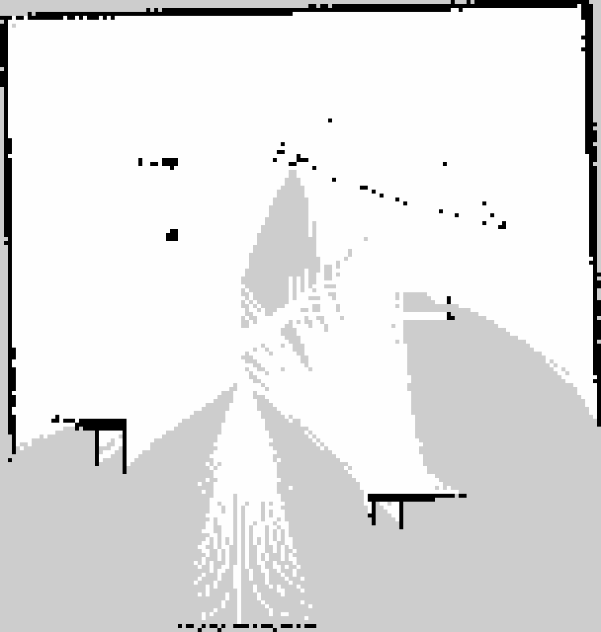
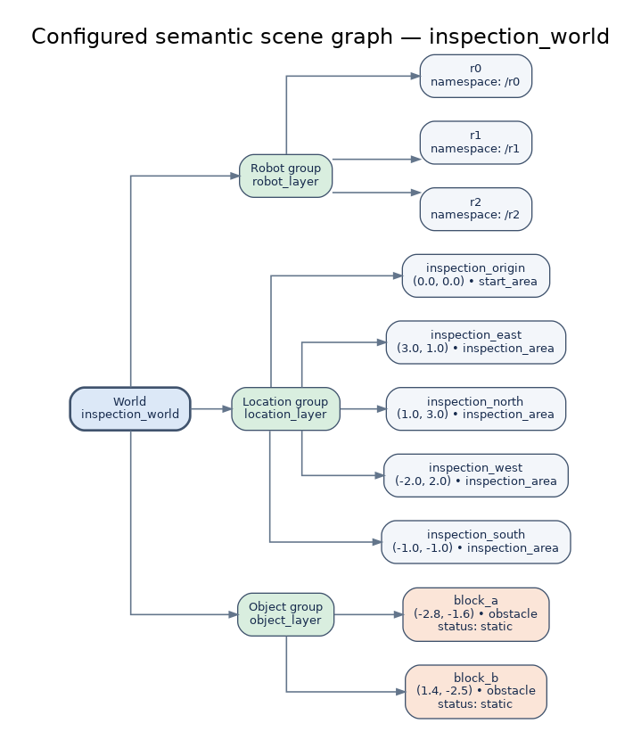

# Multi-Robot Inspection: Simulation and Semantic Planning

## 1. Introduction

This project develops and evaluates a multi-robot inspection baseline using ROS 2 Humble and Gazebo Classic. The system combines three simulated TurtleBot3 Burger robots, independently namespaced sensor and control interfaces, waypoint execution, SLAM-based mapping, and a semantic task-planning pipeline. The work is evaluated through software tests and simulation experiments.

The report distinguishes implemented and tested functionality from proposed research. The waypoint mission and robot-availability recovery were tested in simulation. Semantic planning and scripted event handling were tested separately at the software level; they are not integrated with physical robot execution. Long-term map freshness, sensor degradation handling, and communication-resilient coordination remain research directions.

## 2.1 Multi-Robot Simulation, Sensing, and Mapping

### System configuration

Three TurtleBot3 Burger robots, named r0, r1, and r2, were spawned in a shared Gazebo world at initial positions (0, 0), (2, 0), and (0, 2) metres. Robot-specific namespaces separate command and sensor interfaces, including `/rX/cmd_vel`, `/rX/scan`, `/rX/imu`, and `/rX/odom`. RGB-D streams are configured at 320 × 240 pixels with a target update rate of 10 Hz. Robot-specific TF frame prefixes allow the robots to publish transforms on the shared `/tf` and `/tf_static` topics without reusing frame IDs.

Short measurements in the WSL2 environment were below configured sensor rates. RGB observations were approximately 6.7 Hz for r0 and 7.0 Hz for r1; available depth measurements were approximately 6.5–7.2 Hz. Earlier LiDAR checks measured approximately 3.2–4.0 Hz. These are session-specific observations rather than guaranteed performance figures.

### Waypoint mission and recovery

A centralized waypoint executor ran ten unique waypoints, wp01–wp10, with a goal tolerance of 0.15 m. In the successful A*-enabled Gazebo run, the executor emitted `MISSION_COMPLETE`, recorded all ten waypoint IDs as completed, and ended with empty unresolved and failed-robot lists. The logged final goal distances were approximately 0.048–0.050 m.

Navigation combines a custom A* grid planner with odometry-based path following and a forward LiDAR stop guard. The planner parses the known static collision-box geometry from the Gazebo SDF world, uses a 0.10 m grid resolution and 0.22 m obstacle inflation, and simplifies the resulting route using line-of-sight checks. The safety guard stops for close forward returns at 0.45 m and resumes after clearance exceeds 0.60 m. A separate test across `block_b` found a four-point route with 0.70 m maximum lateral deviation from the direct line. This is static-world planning, not Nav2; dynamic obstacle rerouting and guaranteed collision avoidance have not been established.

The corrected-world integration run on 18 October 2026 used
`inspection_world.world`, with the boundary walls and static obstacles visible
in Gazebo. After the executor started, it reported `MISSION_COMPLETE` with
wp01–wp10 completed and empty `unresolved` and `failed_robots` lists. Logged
goal distances were approximately 0.048–0.050 m, within the 0.15 m tolerance.
The run also logged multiple `OBSTACLE_STOP` and `OBSTACLE_CLEARED` transitions,
including during wp03, wp04, and wp07. This is evidence of the configured
forward LiDAR stop/resume guard in this run, not a guarantee of collision-free
motion or dynamic-obstacle rerouting.


A software-level failure was injected for r0 through the mission failure interface. The executor reported `ROBOT_FAILED` and redistributed four unfinished goals to r1 and r2. The final completed set again contained wp01–wp10. This experiment demonstrates mission-level availability handling in simulation; it is not a test of physical hardware failure.

### Mapping

SLAM Toolbox was run during the mission, producing `maps/inspection_map.pgm` and `maps/inspection_map.yaml`. The map contains 152 × 160 cells at 0.05 m resolution, corresponding to a 7.60 × 8.00 m extent. Cell statistics were 60.1% free, 3.4% occupied, and 36.5% unknown, giving 63.5% known-cell coverage. The map is partial. Its geometric accuracy was not evaluated against a ground-truth map.

{#fig:slam-map width=55%}


### Limitations

The experiments verify a bounded simulation workflow, not a complete autonomous navigation stack. A custom A* global path planner was implemented and tested against static geometry from the SDF world; Nav2 was not configured or validated. The planner does not plan from the saved SLAM map, and the safety guard is not a guarantee of collision-free motion. Sensor-rate observations were short, and mapping accuracy remains unmeasured.

## 2.2 Language-Grounded Semantic Planning and Event Handling

### Scene representation and grounding

The configured scene graph in `config/semantic/scene_graph.json` represents the inspection world, three robots, five named locations, two static obstacles, and their relations. It represents configured world knowledge rather than an automatically perceived scene. Metric attributes include location and obstacle-centre coordinates; semantic attributes include entity types, obstacle status, robot namespaces, and relations.

An explicit hierarchy is represented as **world → entity-category groups → configured entities**.

{#fig:semantic-hierarchy width=68%}
 The world root contains robot, location, and object groups, whose leaves reference IDs in the corresponding entity collections. `validate_scene_hierarchy()` checks the root, groups, entity references, duplicate references, and coverage of configured entities. Tests verify a valid hierarchy and rejection of a dangling location reference.

The deterministic baseline in `semantic_planner.py` grounds explicitly mentioned location IDs and underscore-separated names. It selects `inspect`, `observe`, or `navigate` using keyword rules and distributes tasks round-robin over available robots. It is reproducible but does not perform advanced language understanding, explicit ambiguity resolution, dependency decomposition, or cost-optimised allocation.

### Foundation-model planning and verification

The model-backed planner in `llm_semantic_planner.py` is configured to use the local Ollama model tag `qwen2.5:1.5b`. It uses prompt-based structured generation with JSON output mode and temperature 0; no fine-tuning is used. The prompt restricts actions to `inspect`, `observe`, and `navigate`, lists configured location and robot IDs, prohibits invented targets, and requests an empty task list for ambiguous or unknown requests.

The exact prompt template is shown below; brace-delimited lists are populated from the scene graph.

```text
You convert a robot mission into a JSON task plan.
Return JSON only, with this exact structure:
{"tasks":[{"task_id":"task_001","action":"inspect","target":"inspection_east","robot":"r0"}]}
Allowed actions: inspect, observe, navigate.
Use only these exact location IDs: {configured location IDs}
Use only these robot IDs: {configured robot IDs}
Do not invent targets. If the request is ambiguous or no target is known, return {"tasks":[]}.
Mission: {natural-language mission request}
```

The Ollama request uses JSON output mode, non-streaming generation, and temperature 0. No fine-tuning is used.

The validation layer checks plan structure, non-empty task lists, task objects, unique task IDs, supported actions, known targets, known robots, and robot availability. It also validates the configured hierarchy when present. Unexpected field types are rejected instead of causing set-membership type errors. Regression tests cover invalid plans, alias grounding, invented targets, unavailable robots, and an empty model response for an ambiguity-oriented request. The mocked response verifies response handling; it does not establish that the model reliably resolves every kind of ambiguity. When Ollama returns the prompt's empty-task abstention response, the full planner marks it invalid and does not invoke the deterministic fallback; a regression test covers this path. The deterministic fallback is used for request or response-parsing exceptions and is separately validated.

### Event-driven replanning

The `semantic_events.py` demonstration applies two scripted events: `robot_unavailable` and `target_unavailable`. An unavailable robot is excluded from subsequent assignments. An unavailable target is recorded as blocked and removed from both the active location collection and its hierarchy group, keeping grounding and hierarchy validation consistent. Blocked work is not counted as completed work. In the CLI demonstration, `robot_unavailable` for `r0` reassigned `inspection_east` to `r1` and `inspection_north` to `r2`. The subsequent `target_unavailable` event blocked `inspection_east`, leaving `inspection_north` assigned to `r1`. Both resulting plans had `last_valid: true` and no validation errors. Tests also reject unsupported event types.

This event handler updates planning state and validates the new plan; it is not connected to live Gazebo motion execution. The current system does not demonstrate the LLM regenerating a plan after every event, or enforce sensor-capability, task-dependency, and physical-safety constraints at the semantic-planning layer.

### Verification results and limitations

The latest ROS 2 package test run collected 53 tests: 52 passed, 1 was skipped, and none failed. Two lint-tool deprecation warnings did not fail the run. As a concrete negative verification case, a plan targeting `unknown_place` was rejected (`valid = false`) with the error `tasks[0]: unknown target 'unknown_place'.` The hierarchy tests also reject a dangling location reference. These tests verify configured software behaviour; they do not establish automatic scene perception, reliable ambiguity resolution, or live-robot execution of semantic event replanning.

## 2.3 Long-Term Deployment Challenges

### Operational setting

A multi-robot inspection system that works during a short simulation may not remain reliable over weeks or months. Long-term deployment introduces gradual hardware degradation, changing sensor quality, environmental changes, intermittent communication, and uncertainty about whether previously recorded information is still valid. Long-term SLAM research identifies appearance variation, environmental reconfiguration, map maintenance, and computational efficiency as important challenges [@sousa2023longterm].

### Hardware and sensing degradation

Wheel wear, reduced battery capacity, motor faults, and calibration drift can change a robot's motion and sensing performance. Dust, moisture, lens contamination, and changing illumination may degrade camera observations, while LiDAR measurements may become noisy or incomplete. A robot should therefore monitor sensor message rates, timestamps, diagnostic status, localization uncertainty, and discrepancies between predicted and observed motion.

A degraded sensor should not automatically be treated as a reliable source of evidence. The system could reduce confidence in that modality, compare it with independent observations, request another robot to inspect the same area, or pause tasks that depend on unavailable measurements. Such responses require explicit thresholds and validation; they are design proposals, not capabilities demonstrated by the current simulation.

### Environmental and semantic-map changes

Static maps and semantic scene graphs can become stale when doors are closed, furniture is moved, obstacles appear, or inspection locations change. A geometrically traversable location may also become operationally unsuitable. For example, a target may still exist in the map but be inaccessible to a robot whose camera or mobility capability has degraded.

A long-term system should distinguish temporary observations from persistent changes. Repeated observations, confidence scores, timestamps, and provenance can help prevent one noisy measurement from permanently rewriting the shared map. Conflicting observations should trigger verification or human review rather than an unqualified update. Map maintenance must balance adaptation to real changes against preserving useful information from earlier visits [@sousa2023longterm].

### Communication, coordination, and energy

Communication failures can leave robots with inconsistent maps, duplicate assignments, or outdated availability information. A central planner can simplify coordination but also creates a potential single point of failure. A distributed design can improve resilience but must manage conflicting updates, duplicate work, and limited bandwidth.

Robots should exchange compact state updates, task ownership, map-change evidence, and capability status when communication is available. If disconnected, each robot should follow a bounded local policy, avoid unsafe tasks, and reconcile its state after reconnecting. Task allocation should account for remaining energy, travel cost, sensor capability, and the cost of interrupting or transferring an unfinished task [@mayya2021resilient].

### Safe use of foundation models

A language model can translate a human request into a high-level task plan, but it should not be the authority that directly commands motors or bypasses safety checks. Model output may contain unsupported targets, invalid actions, or assumptions that no longer match the world. A deterministic validation layer should check entity grounding, robot availability, action preconditions, task dependencies, and safety constraints before execution. Runtime monitoring should stop or replan when observations contradict the plan.

In this project, the Qwen-based planner grounds tasks against a configured scene graph and rejects invalid targets. The scene graph is not automatically perceived, and the event demonstration uses a deterministic planner rather than demonstrating full model-driven replanning. These limitations mean that safe long-term adaptation remains a research and engineering challenge, not a validated deployment capability.

### Summary

Long-term reliability requires more than successful initial planning. It requires monitoring, uncertainty-aware map maintenance, capability-aware reassignment, safe behavior during communication loss, and human escalation when evidence is insufficient. These mechanisms should be evaluated over repeated missions and controlled degradation scenarios before any real-world deployment claim is made.

## 2.4 Open Research Problem and Proposed Approach

### Research problem

**How can a multi-robot inspection system detect stale semantic knowledge and robot capability changes, then reassign tasks safely while maintaining mission progress?**

A semantic planner can generate a plausible plan from a scene graph, but the plan may become invalid after execution begins. A target may be blocked or relocated, a robot may lose a required sensor, or communication delays may leave the planner with outdated availability information. These issues become more difficult in multi-robot settings because robots may hold inconsistent state estimates and task reassignment can create duplicated work or conflicting actions.

Prior work provides important building blocks. Long-term SLAM research addresses map maintenance in changing environments [@sousa2023longterm]. Resilient task-allocation research examines how tasks can be redistributed when robot capabilities or operating conditions change [@mayya2021resilient]. Work on feedback-driven language-model planning shows the value of incorporating environmental feedback into high-level plans [@huang2023innermonologue]. However, combining these ideas into a continuously validated, capability-aware semantic mission process is a useful research direction for long-term multi-robot inspection.

### Assumptions and scope

The proposed study assumes a team of mobile robots with individual sensor and mobility capabilities, a shared semantic scene graph, and a mission expressed as a set of inspection tasks. The robots may experience temporary unavailability, degraded sensing, blocked targets, and intermittent communication. The initial study would be conducted in simulation, with controlled disturbances and repeatable task sequences.

The scene graph is not assumed to be perfectly accurate. Observations may be delayed, incomplete, or contradictory. The language model proposes high-level tasks but does not control low-level motion directly. Navigation and safety checks remain the responsibility of conventional robot software and independent validation mechanisms.

### Conceptual approach

The proposed architecture has five stages:

1. **Ground the mission.** Convert a natural-language request into structured tasks with explicit targets, required capabilities, dependencies, and completion conditions.
2. **Validate against current state.** Check whether each target exists and is believed to be available, whether the assigned robot has the required capabilities, and whether task dependencies and safety constraints are satisfied.
3. **Monitor execution.** Compare task outcomes with expected observations, track robot availability and sensor health, and timestamp map evidence. A discrepancy should mark the affected information as uncertain rather than silently treating it as current.
4. **Reassess and reassign.** When a robot becomes unavailable or a target changes, invalidate affected assignments and compute a revised allocation using remaining capabilities, travel cost, task priority, and energy constraints.
5. **Verify before resuming.** Validate the revised plan, prevent duplicate ownership of tasks, and require additional observation or human review when evidence is insufficient. Low-level safety mechanisms remain active throughout replanning.

The language model would be used for interpreting instructions and proposing semantic task structures. Deterministic checks and task-allocation logic would constrain the executable result. This separation limits the consequences of unsupported model output and makes the system easier to test.

### Evaluation plan

The proposed experiments would compare a static-plan baseline, a reactive reassignment baseline, and the proposed state-aware approach across repeated simulation runs. Disturbances would include robot unavailability, target blockage, sensor degradation, stale semantic observations, and communication loss.

The main measures would be:

- **Mission completion rate:** fraction of required tasks completed correctly.
- **Recovery time:** time from detecting a disturbance to restoring valid task execution.
- **Reassignment overhead:** additional travel or execution cost after a disturbance.
- **Stale-state failures:** number of assignments made using information that should have been invalidated.
- **Duplicate or conflicting assignments:** tasks simultaneously owned by multiple robots or assigned to unavailable robots.
- **Safety violations:** collisions or execution of tasks that fail required safety checks.
- **Communication overhead:** volume and frequency of state updates needed for coordination.

Results should be reported across multiple runs with variability, not only a single successful demonstration. Ablation tests could remove map freshness checks, capability monitoring, or feedback-driven replanning individually to measure their contributions. The evaluation should also record cases where the system stops and requests human intervention rather than claiming autonomous recovery.

### Expected contribution and limitations

The expected contribution is a testable framework for connecting semantic grounding, map freshness, robot capability monitoring, and resilient task reassignment. The research hypothesis is that explicit state validation and capability-aware reassignment will reduce stale-state failures and improve recovery after disturbances compared with static planning.

This is a proposed research direction, not a result established by the current implementation. The existing project demonstrates configured-scene grounding, plan validation, and scripted availability events, but does not yet implement long-term map freshness estimation or evaluate this complete architecture. Those elements would require further implementation and controlled experiments before the hypothesis could be accepted or rejected.

## 3. Reproducibility

The experiments were developed on Ubuntu 22.04 under WSL2 with ROS 2 Humble and Gazebo Classic. The semantic demonstrations use the configured scene graph in `ros2_ws/src/multi_robot_sim/config/semantic/scene_graph.json`. The model-backed planner additionally requires a working local Ollama installation with `qwen2.5:1.5b` available.

Build the ROS 2 package and source the workspace:

```bash
source /opt/ros/humble/setup.bash
cd ~/ltu_rai_assignment/ros2_ws
colcon build --packages-select multi_robot_sim --symlink-install
source install/setup.bash

```


### Reproducing Task 2.1

Start Gazebo in one terminal using `ros2 launch multi_robot_sim multi_robot.launch.py` after sourcing ROS 2 and the workspace and setting `TURTLEBOT3_MODEL=burger`. In a second sourced terminal, run `ros2 run multi_robot_sim mission_executor`. Leave the mission free of injected failures and verify `MISSION_COMPLETE`, all ten waypoint IDs in `completed`, and empty `unresolved` and `failed_robots` lists in the executor output.

For a separate software-level recovery test, restart the simulation and executor. While `r0` has unfinished work, publish `r0` once on `/mission/failed_robot` using `ros2 topic pub --once /mission/failed_robot std_msgs/msg/String "{data: 'r0'}"`. Observe `ROBOT_FAILED` and reassignment messages. Redistribution depends on injection timing; the recorded run transferred four unfinished goals. This does not simulate physical hardware failure.

Run the semantic planning demonstrations:

```bash
ros2 run multi_robot_sim semantic_planner
ros2 run multi_robot_sim llm_semantic_planner
ros2 run multi_robot_sim semantic_events
```

Run the package tests:

```bash
colcon test --packages-select multi_robot_sim
colcon test-result --verbose
```

The latest observed test summary was 53 tests collected, 52 passed, 1 skipped, and zero failures. Sensor publication rates and mapping coverage were measured in short simulation sessions and should not be interpreted as long-duration performance benchmarks. The waypoint mission, software-level robot-failure recovery, semantic planning, and event handling were tested as described in their respective sections; the semantic pipeline is not connected to physical robot execution.

## 4. Conclusion

This project establishes a simulation baseline for multi-robot inspection and a separate semantic planning prototype. The three-robot setup, namespaced sensing and control interfaces, ten-waypoint mission, scripted robot-availability recovery, and partial SLAM map were verified in simulation. The semantic planning component grounds requests against configured world knowledge, validates structured tasks, and demonstrates scripted responses to robot and target unavailability.

The results also expose important limits. Sensor rates depend on simulation load, and the map retains substantial unknown coverage. A custom A* global planner is implemented and tested using static Gazebo SDF geometry rather than the saved SLAM map; this is not Nav2, does not demonstrate dynamic-obstacle rerouting, and does not guarantee collision avoidance. The semantic scene graph is configured rather than automatically perceived, and semantic event handling is not integrated with live robot motion execution. These constraints motivate the proposed research on map freshness, capability-aware allocation, and safe replanning under changing conditions.
